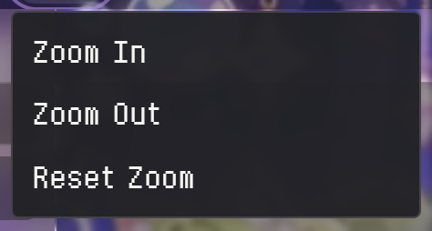

# Antigravity Custom Theme

A wallpaper background, adjustable transparency and your own font for the
Antigravity desktop app — configured from **Settings → Appearance**, with no
debug port and no background daemon.



```bash
git clone https://github.com/linnerinrin/antigravity-custombg.git
cd antigravity-custombg
```

Then double-click `安装.bat`. MIT licensed.

## What it does

| Feature | Where | Notes |
| --- | --- | --- |
| **Wallpaper** | Appearance → Custom Theme → Wallpaper | Any image file; copied into the config folder so moving the original does not break it |
| **Wallpaper transparency** | same card | 0 % = solid overlay, 100 % = wallpaper fully visible |
| **Sidebar transparency** | same card | Glass effect fades out as the value rises, so text stays legible |
| **Custom font** | same card | TTF / OTF / WOFF / WOFF2 / TTC. Optionally applies to the terminal and code blocks too |

Light and dark themes each get their own colour palette, so the overlay never
turns into a white sheet over white text.

## Install

Requirements: **Node.js 18+**, Antigravity 2.x on Windows x64.

1. Double-click **`安装.bat`** (Install).
2. Wait for Antigravity to restart.
3. Open **Settings → Appearance** and scroll to the **Custom Theme** card.

The installer:

- stops Antigravity,
- saves a pristine copy of `resources/app.asar` next to the original as
  `app.asar.custom-theme.bak`,
- appends an injection block to `dist/main.js` and `dist/preload.js`,
- verifies the rebuilt archive before swapping it in,
- restarts the app.

Any failure leaves the running app untouched.

## Uninstall

Double-click **`卸载.bat`** (Uninstall), or:

```bash
node lib/patcher.cjs --uninstall
```

This restores `app.asar` from the backup. Your wallpapers, fonts and slider
values stay in `%USERPROFILE%\.gemini\config\agy-bg\` — delete that folder to
reset them completely.

## Command line

```bash
node lib/patcher.cjs --check       # report what is currently installed
node lib/patcher.cjs --build       # produce a candidate archive, change nothing
node lib/patcher.cjs --install     # build, verify, swap in
node lib/patcher.cjs --uninstall   # restore the pristine archive
```

Flags: `--asar <path>` to target a non-default installation, `--no-kill` to skip
terminating the app, `--quiet` for errors only.

## How it works

The injection is two self-contained IIFEs wrapped in marker comments:

```
// ===== AGY_BG_BEGIN =====
...
// ===== AGY_BG_END ====
```

- **`dist/main.js`** registers IPC handlers: read the config, build the CSS
  (embedding the wallpaper and font as `data:` URIs), open file pickers, persist
  changes.
- **`dist/preload.js`** injects a single `<style>` element and mounts the
  Custom Theme card in the Appearance screen, keeping it as the last section so
  a theme switch does not reshuffle it.

Re-running the installer strips the old block first, so upgrades do not stack
duplicates. The block markers are the same ones earlier builds used, which makes
an in-place upgrade safe.

`lib/asar.cjs` is a small, dependency-free ASAR reader/writer written for this
project; it recomputes the header offsets and per-file integrity hashes so the
archive stays valid for Electron.

### Colour palette

Two palettes are emitted as literals rather than resolved from CSS variables.
Variables referenced from `:root` are computed there, so flipping `.dark` on
`<body>` cannot change an already-resolved `--background` — that was the original
cause of an unreadable white overlay in dark mode.

### Dropdown menus

Antigravity's top menus reuse the `bg-sidebar` class, and their *parent* toolbar
carries it too. The toolbar therefore only gets a background colour, while the
`backdrop-filter` is limited to the real sidebar column — otherwise the popup is
blurred twice and washes out.

## Configuration files

```
%USERPROFILE%\.gemini\config\agy-bg\
  config.json      slider values, current wallpaper and font names
  wallpaper.jpg    active wallpaper
  font.ttf         active font
```

`config.json` keys: `enabled`, `image`, `dimming` (opacity of the overlay,
0–100), `sidebarTrans` (0–100), `veil` (extra tint strength), `fontFile`,
`fontApplyCode`.

## Compatibility

Built and verified against **Antigravity 2.33.0**
(Electron 44.9.1 / Chrome 152). The patch only appends to two JavaScript files,
so minor version bumps are usually fine; run `--check` after a major update.

It coexists with the Gemini Neko Cockpit HUD plugin — that one uses its own
`GEMINI_NEKO_HUD_BEGIN/END` markers and the two blocks never touch each other.
Reinstalling or repairing Antigravity wipes both patches, along with the backup;
keep a copy of the plugin folder if you rely on it.

## Notes

- No network access at runtime. Nothing leaves the machine.
- Fonts are embedded as base64, so a 20 MB font adds ~27 MB to the injected CSS.
  Prefer a subset font if startup feels slow.
- If the window shows a bare background for a split second on launch, that is the
  asynchronous IPC round-trip that supplies the CSS; it resolves immediately.
