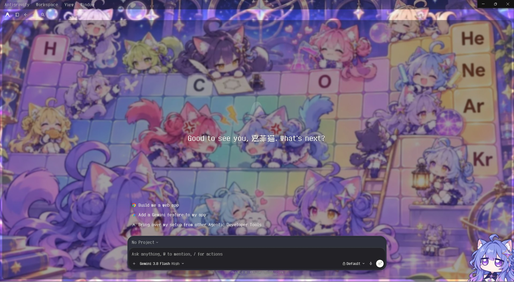

# Antigravity Custom Theme

给 Antigravity 桌面版换上**壁纸背景**、**可调透明度**和**你自己的字体**——全部在
**设置 → 外观**里操作，不需要开调试端口，也不需要常驻守护进程。



> **关于截图**：右下角那只哈基米猫娘桌宠是另一个独立插件
> （[Antigravity Observer](https://github.com/yunjuanyunshu114-byte/antigravity-observer)），
> **不属于本插件**。本插件只负责背景、透明度和字体。

```bash
git clone https://github.com/linnerinrin/antigravity-custombg.git
cd antigravity-custombg
```

然后双击 `安装.bat`。MIT 协议。

## 功能

| 功能 | 位置 | 说明 |
| --- | --- | --- |
| **壁纸** | 外观 → Custom Theme → Wallpaper | 任意图片文件，会复制进配置目录，移动原图不影响 |
| **壁纸透明度** | 同一张卡片 | 0% 遮罩最实，100% 壁纸完全透出 |
| **侧边栏透明度** | 同一张卡片 | 越透玻璃感越弱，保证文字始终看得清 |
| **自定义字体** | 同一张卡片 | 支持 TTF / OTF / WOFF / WOFF2 / TTC，可选择是否也应用到终端和代码块 |

明暗主题各有一套配色，所以深色模式下不会出现白底白字。

## 安装

需要 **Node.js 18+**，Windows x64 上的 Antigravity 2.x。

1. 双击 **`安装.bat`**。
2. 等 Antigravity 自动重启。
3. 打开 **设置 → 外观**，滑到最下面的 **Custom Theme** 卡片。

安装脚本会：

- 关闭 Antigravity；
- 把 `resources/app.asar` 的原始副本存为 `app.asar.custom-theme.bak`；
- 在 `dist/main.js` 和 `dist/preload.js` 末尾追加注入块；
- 校验重建后的归档合法后才替换进去；
- 重启应用。

任何一步失败都不会动到正在运行的应用。

## 卸载

双击 **`卸载.bat`**，或者：

```bash
node lib/patcher.cjs --uninstall
```

它会从备份恢复 `app.asar`。你的壁纸、字体和滑块数值都留在
`%USERPROFILE%\.gemini\config\agy-bg\`，删掉那个目录才是彻底重置。

## 命令行

```bash
node lib/patcher.cjs --check       # 查看当前安装状态
node lib/patcher.cjs --build       # 只生成候选归档，不改任何东西
node lib/patcher.cjs --install     # 生成、校验、替换
node lib/patcher.cjs --uninstall   # 恢复原始归档
```

附加参数：`--asar <path>` 指定非默认安装路径，`--no-kill` 跳过结束进程，
`--quiet` 只输出错误。

## 实现原理

注入的是两个自包含的 IIFE，外面包着标记注释：

```
// ===== AGY_BG_BEGIN =====
...
// ===== AGY_BG_END ====
```

- **`dist/main.js`** 注册 IPC：读配置、拼 CSS（壁纸和字体都嵌成 `data:` URI）、
  打开文件选择框、保存改动。
- **`dist/preload.js`** 注入一个 `<style>` 元素，并在外观页挂上 Custom Theme 卡片；
  卡片始终保持在最后一位，所以切换主题不会打乱它的位置。

重复安装会先剥离旧块，不会叠加。标记注释与早期版本逐字节一致，所以能原地升级。

`lib/asar.cjs` 是为这个项目写的零依赖 ASAR 读写器，会重算头部偏移和每文件的
integrity 哈希，保证 Electron 能正常加载。

### 配色

两套配色都以字面量直接输出，而不是靠 CSS 变量层层继承。从 `:root` 引用的变量会在
`:root` 处就求值，在 `<body>` 上翻 `.dark` 改不动已经解析好的 `--background`——这正是
最初深色模式下出现白色遮罩、白字看不见的原因。

### 下拉菜单

Antigravity 的顶部菜单复用了 `bg-sidebar` 这个类，而它**父级的顶部工具条**也带这个类。
所以工具条只拿背景色，`backdrop-filter` 只加给真正的侧边栏列——否则弹层会被糊两遍，
直接洗白。

## 配置文件

```
%USERPROFILE%\.gemini\config\agy-bg\
  config.json      滑块数值、当前壁纸和字体名
  wallpaper.jpg    当前壁纸
  font.ttf         当前字体
```

`config.json` 键：`enabled`、`image`、`dimming`（遮罩浓度 0–100）、
`sidebarTrans`（0–100）、`veil`（额外色调强度）、`fontFile`、`fontApplyCode`。

## 兼容性

针对 **Antigravity 2.33.0**（Electron 44.9.1 / Chrome 152）开发并验证。补丁只往两个
JS 文件末尾追加，小版本升级通常没事；大版本升级后跑一下 `--check`。

可以和 Gemini Neko Cockpit 猫娘 HUD 插件共存——它用的是自己的
`GEMINI_NEKO_HUD_BEGIN/END` 标记，两块互不干扰。重装或修复 Antigravity 会把两个补丁
连同备份一起抹掉，依赖它的话请保留一份插件目录的副本。

## 注意

- 运行时零联网，任何数据都不离开本机。
- 字体会以 base64 嵌入，20 MB 的字体大约会给注入的 CSS 增加 27 MB。启动嫌慢就用子集字体。
- 启动瞬间偶尔闪一下纯背景，那是异步 IPC 还没把 CSS 送到的中间帧，随后立刻恢复。

---

# English

Give the Antigravity desktop app a **wallpaper background**, **adjustable
transparency** and **your own font** — all from **Settings → Appearance**, with
no debug port and no background daemon.


> **About the screenshot**: the catgirl desktop pet in the bottom-right corner is a
> separate plugin ([Antigravity Observer](https://github.com/yunjuanyunshu114-byte/antigravity-observer))
> and is **not** part of this project. This plugin only handles background,
> transparency and fonts.

```bash
git clone https://github.com/linnerinrin/antigravity-custombg.git
cd antigravity-custombg
```

Then double-click `安装.bat`. MIT licensed.

## What it does

| Feature | Where | Notes |
| --- | --- | --- |
| **Wallpaper** | Appearance → Custom Theme → Wallpaper | Any image file; copied into the config folder so moving the original does not break it |
| **Wallpaper transparency** | same card | 0 % = solid overlay, 100 % = wallpaper fully visible |
| **Sidebar transparency** | same card | Glass effect fades out as the value rises, so text stays legible |
| **Custom font** | same card | TTF / OTF / WOFF / WOFF2 / TTC. Optionally applies to the terminal and code blocks too |

Light and dark themes each get their own colour palette, so the overlay never
turns into a white sheet over white text.

## Install

Requirements: **Node.js 18+**, Antigravity 2.x on Windows x64.

1. Double-click **`安装.bat`** (Install).
2. Wait for Antigravity to restart.
3. Open **Settings → Appearance** and scroll to the **Custom Theme** card.

The installer:

- stops Antigravity,
- saves a pristine copy of `resources/app.asar` next to the original as
  `app.asar.custom-theme.bak`,
- appends an injection block to `dist/main.js` and `dist/preload.js`,
- verifies the rebuilt archive before swapping it in,
- restarts the app.

Any failure leaves the running app untouched.

## Uninstall

Double-click **`卸载.bat`** (Uninstall), or:

```bash
node lib/patcher.cjs --uninstall
```

This restores `app.asar` from the backup. Your wallpapers, fonts and slider
values stay in `%USERPROFILE%\.gemini\config\agy-bg\` — delete that folder to
reset them completely.

## Command line

```bash
node lib/patcher.cjs --check       # report what is currently installed
node lib/patcher.cjs --build       # produce a candidate archive, change nothing
node lib/patcher.cjs --install     # build, verify, swap in
node lib/patcher.cjs --uninstall   # restore the pristine archive
```

Flags: `--asar <path>` to target a non-default installation, `--no-kill` to skip
terminating the app, `--quiet` for errors only.

## How it works

The injection is two self-contained IIFEs wrapped in marker comments:

```
// ===== AGY_BG_BEGIN =====
...
// ===== AGY_BG_END ====
```

- **`dist/main.js`** registers IPC handlers: read the config, build the CSS
  (embedding the wallpaper and font as `data:` URIs), open file pickers, persist
  changes.
- **`dist/preload.js`** injects a single `<style>` element and mounts the
  Custom Theme card in the Appearance screen, keeping it as the last section so
  a theme switch does not reshuffle it.

Re-running the installer strips the old block first, so upgrades do not stack
duplicates. The block markers match earlier builds byte for byte, which makes an
in-place upgrade safe.

`lib/asar.cjs` is a small, dependency-free ASAR reader/writer written for this
project; it recomputes the header offsets and per-file integrity hashes so the
archive stays valid for Electron.

### Colour palette

Two palettes are emitted as literals rather than resolved from CSS variables.
Variables referenced from `:root` are computed there, so flipping `.dark` on
`<body>` cannot change an already-resolved `--background` — that was the original
cause of an unreadable white overlay in dark mode.

### Dropdown menus

Antigravity's top menus reuse the `bg-sidebar` class, and their *parent* toolbar
carries it too. The toolbar therefore only gets a background colour, while the
`backdrop-filter` is limited to the real sidebar column — otherwise the popup is
blurred twice and washes out.

## Configuration files

```
%USERPROFILE%\.gemini\config\agy-bg\
  config.json      slider values, current wallpaper and font names
  wallpaper.jpg    active wallpaper
  font.ttf         active font
```

`config.json` keys: `enabled`, `image`, `dimming` (opacity of the overlay,
0–100), `sidebarTrans` (0–100), `veil` (extra tint strength), `fontFile`,
`fontApplyCode`.

## Compatibility

Built and verified against **Antigravity 2.33.0**
(Electron 44.9.1 / Chrome 152). The patch only appends to two JavaScript files,
so minor version bumps are usually fine; run `--check` after a major update.

It coexists with the Gemini Neko Cockpit HUD plugin — that one uses its own
`GEMINI_NEKO_HUD_BEGIN/END` markers and the two blocks never touch each other.
Reinstalling or repairing Antigravity wipes both patches, along with the backup;
keep a copy of the plugin folder if you rely on it.

## Notes

- No network access at runtime. Nothing leaves the machine.
- Fonts are embedded as base64, so a 20 MB font adds ~27 MB to the injected CSS.
  Prefer a subset font if startup feels slow.
- If the window shows a bare background for a split second on launch, that is the
  asynchronous IPC round-trip that supplies the CSS; it resolves immediately.
